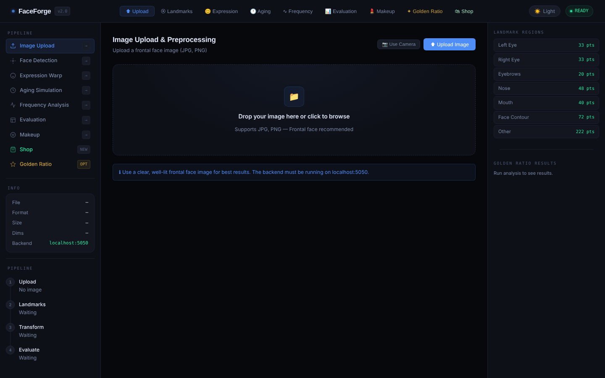
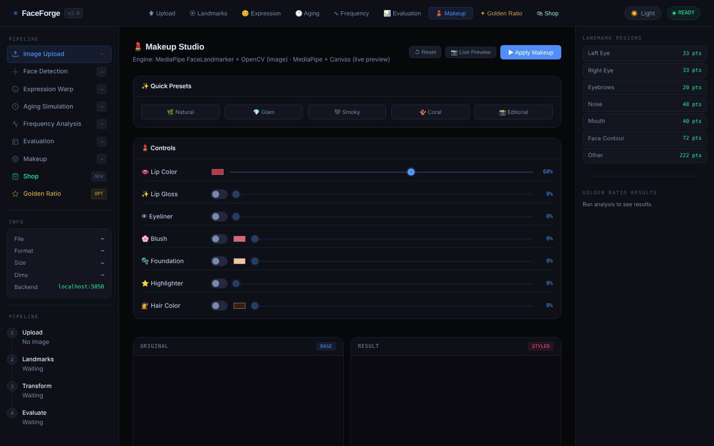
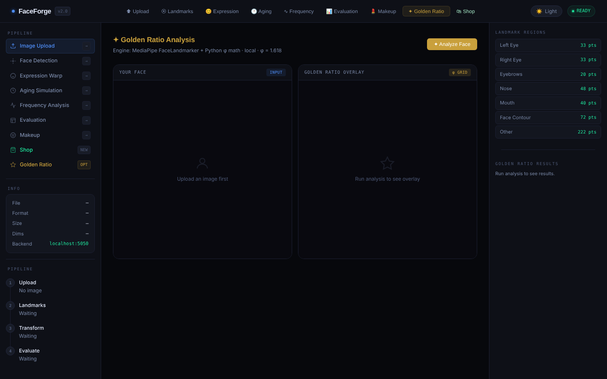

# FaceForge — Facial Analysis & Transformation System

A web application for face analysis and editing. It detects a 478-point facial landmark mesh, then applies expression warps, AI aging, digital makeup, golden-ratio analysis and a live virtual try-on shop. It also measures how much each transformation changed the image.

Group project for **CENG 384** at Ankara Bilim University, built by a 7-person team.
**My role: team lead.** I coordinated the team and owned the SRS/SDD documents, the UI prototype and the final presentation.



## Features

| Module | What it does | Engine |
|---|---|---|
| Landmark detection | 478-point face mesh grouped by region (eyes, brows, nose, mouth, contour) | MediaPipe FaceLandmarker |
| Expression manipulation | Smile, eyebrow raise, lip fullness and face slimming | Delaunay triangulation warp (OpenCV) |
| Aging / de-aging | Age a face forward or back with presets or custom intensity | MediaPipe + OpenCV → fal.ai FLUX Kontext; Gemini for gender detection |
| Frequency analysis | 2D Fourier spectrum of the image | NumPy FFT |
| Quantitative evaluation | Compares original and transformed image | MSE · PSNR · SSIM |
| Makeup studio | Lips, gloss, eyeliner, blush, foundation, highlighter, hair color; presets and live camera preview | MediaPipe + OpenCV / Canvas, hair segmentation |
| Golden ratio | Scores facial proportions against φ = 1.618, with an overlay and an optional "golden warp" | MediaPipe + Python math |
| Virtual try-on shop | Live camera try-on of glasses, earrings, necklaces and wigs, plus a cart and AI-generated "haul" image | MediaPipe in the browser + fal.ai |

## Screenshots

| Makeup studio | Golden ratio analysis |
|---|---|
|  |  |

## Tech stack

**Backend:** Python, Flask, OpenCV, MediaPipe, NumPy, Pillow
**Frontend:** HTML, CSS, vanilla JavaScript, Canvas, MediaPipe Tasks (in-browser)
**AI services:** fal.ai (FLUX), Google Gemini

## Run it locally

```bash
pip install -r requirements.txt

# AI features (aging, wigs, try-on images) need API keys:
export FAL_KEY="your-fal-ai-key"
export GEMINI_API_KEY="your-gemini-key"

python3 backend.py        # → http://localhost:5050
```

Open `http://localhost:5050` in Chrome. Landmarks, expression warp, makeup, frequency, evaluation and golden ratio all run locally without any API key.

## API

| Endpoint | Purpose |
|---|---|
| `POST /api/landmarks` | Detect the face mesh |
| `POST /api/expression` | Expression warp |
| `POST /api/aging` | Aging / de-aging |
| `POST /api/makeup` | Apply makeup |
| `POST /api/hair_color` | Recolor hair |
| `POST /api/golden_ratio` · `/api/golden_warp` | Proportion analysis and correction |
| `POST /api/frequency` | FFT spectrum |
| `POST /api/evaluation` | MSE / PSNR / SSIM |
| `POST /api/shop/*` | Try-on shop: wig generation, product preview, checkout image |

All images are sent as base64 data URLs.

## Project structure

```
├── backend.py              # Flask API: all image processing
├── index.html              # Single-page frontend
├── css/style.css
├── js/                     # One module per feature (landmarks, aging, makeup, shop, …)
├── assets/                 # Try-on product images (glasses, earrings, necklaces, wigs)
├── face_landmarker.task    # MediaPipe face model
└── hair_segmenter.tflite   # MediaPipe hair segmentation model
```
